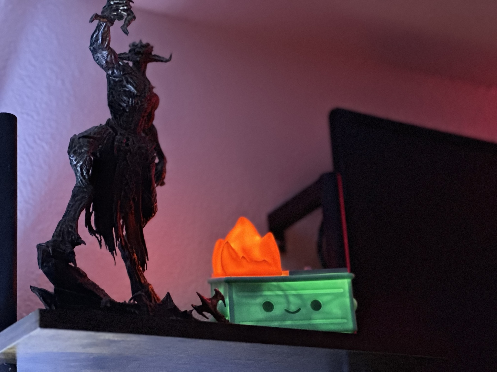
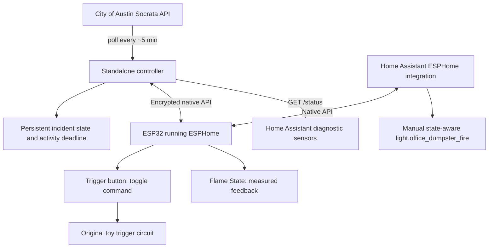
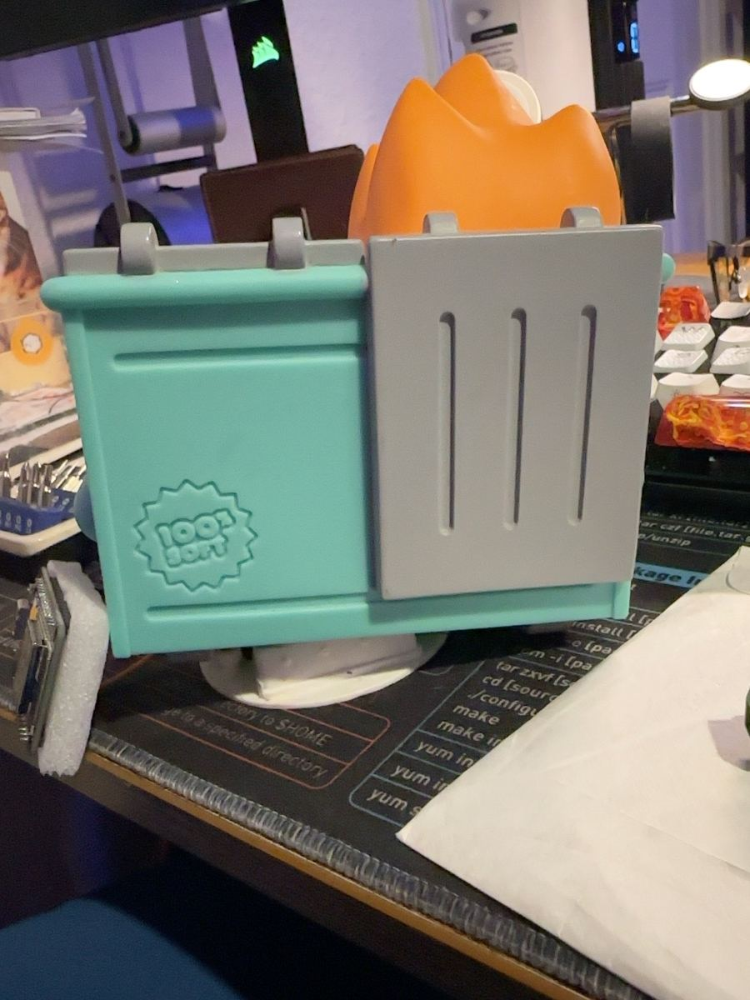
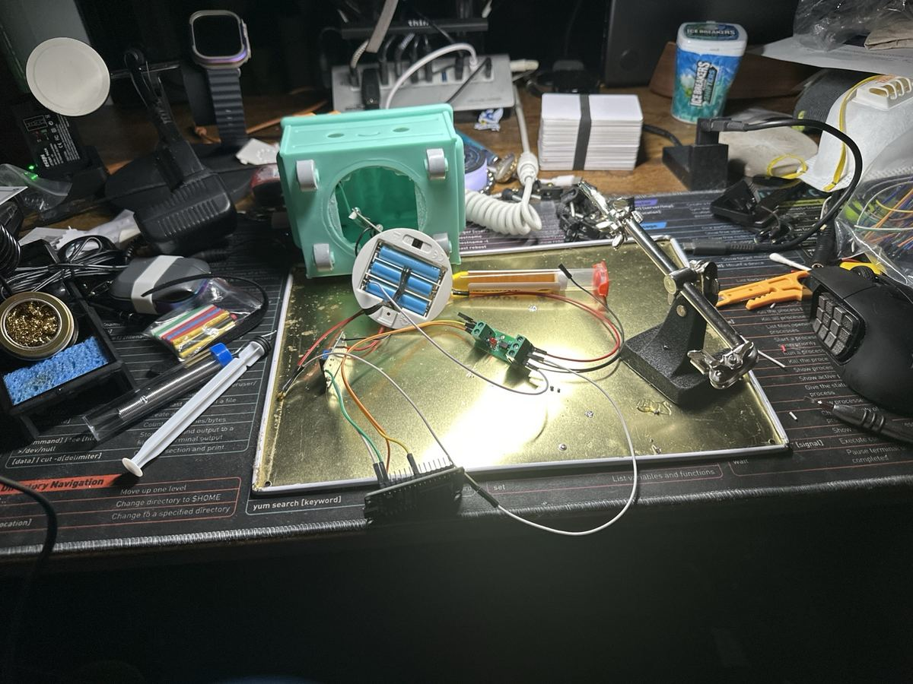
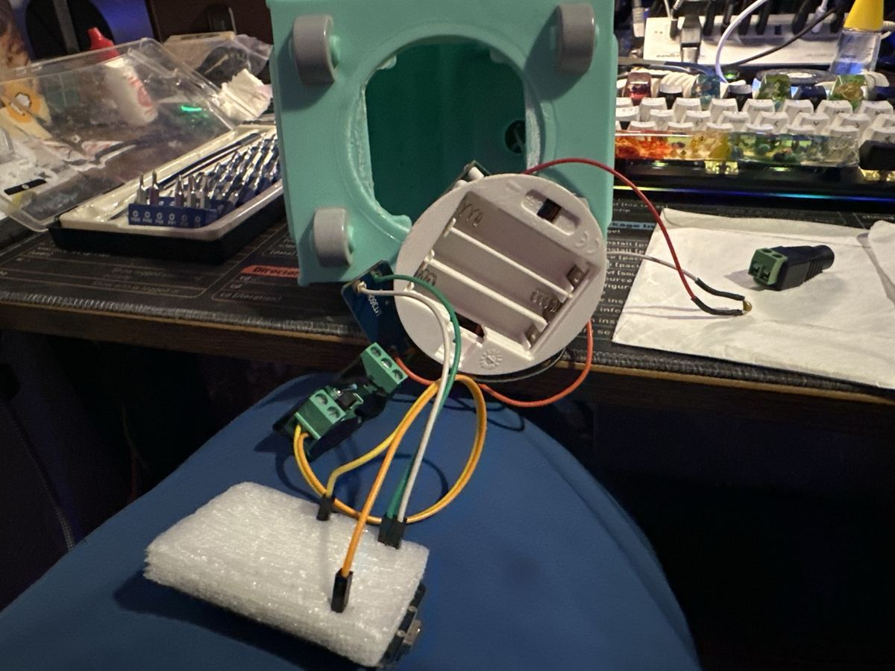
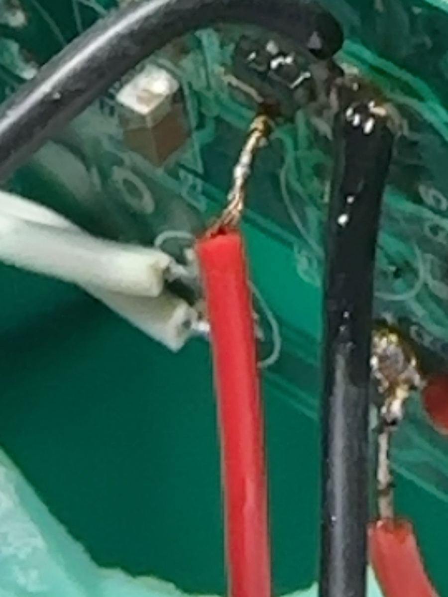
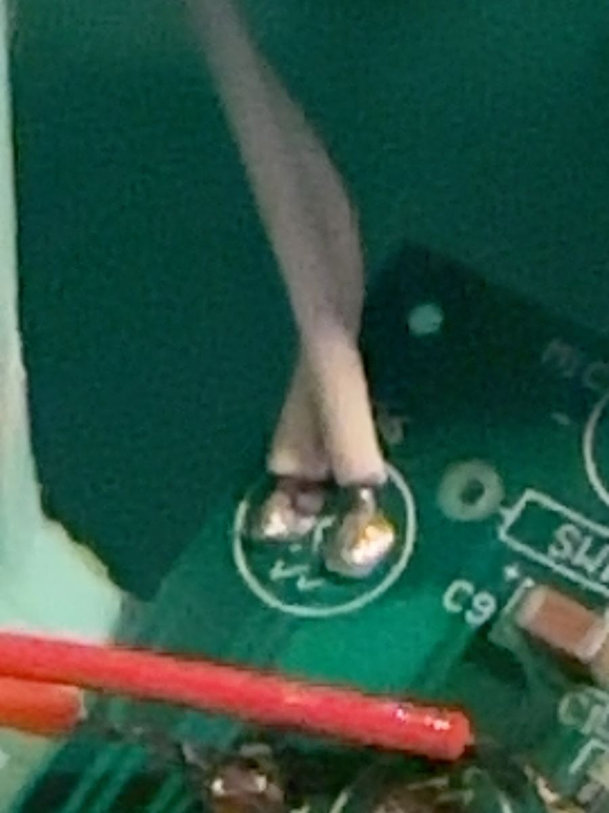
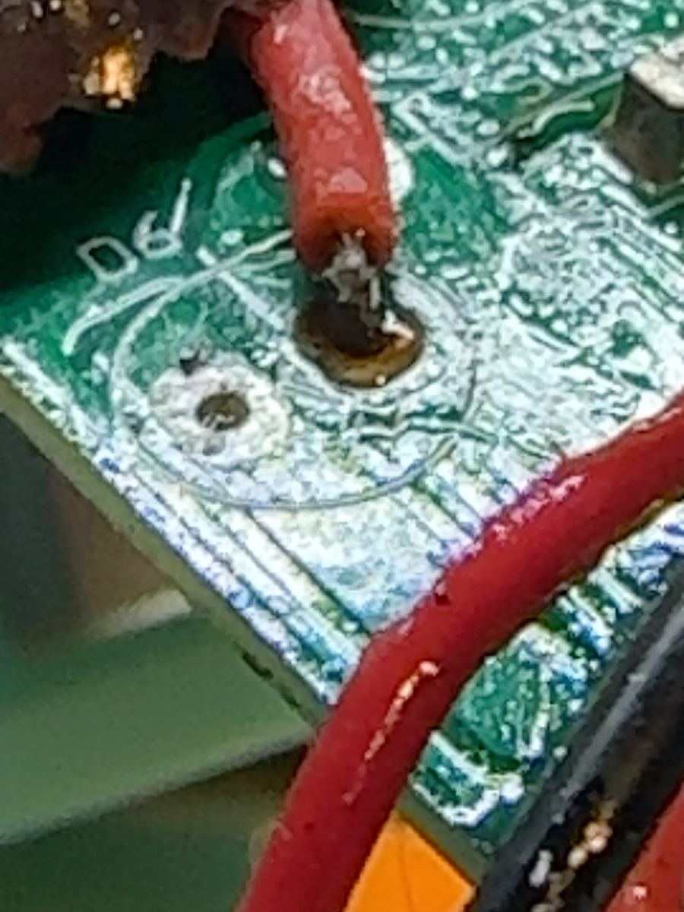

# Dumpster Fire

A physical dumpster-fire night light that turns on when the City of Austin reports an actual **dumpster fire** or **trash fire**.

This started as a joke-sized smart-home project and turned into a surprisingly deep exercise in reverse-engineering a cheap toy, taming an extremely high-impedance trigger circuit, adding real state feedback, integrating ESPHome with Home Assistant, and finally wiring the whole thing to Austin's public fire-dispatch data.



*The finished Dumpster Fire lighting up the shelf, his cheerful demeanor contrasted by the Daedric Prince of Domination to the right.*

## What it does

The finished system watches Austin's real-time fire incident dataset for these exact dispatch categories:

- `DUMP - Dumpster Fire`
- `TRASH - Trash Fire`

The standalone controller records unseen incident IDs, checks the measured flame state
through ESPHome, and presses the physical toggle only when needed. New incidents extend
the activity deadline; when it expires, the controller turns the lamp off only if the
flame sensor still reports it on. Home Assistant retains the ESPHome device, its
Trigger button and Flame State sensor, plus a state-aware `light.office_dumpster_fire`
for manual control. The old Home Assistant incident poller and automations are no
longer part of the active deployment.

The result is a physical indicator for:

> **Austin has had dumpster/trash-fire activity recently.**

## The toy

The base device is the [**100% Soft Dumpster Fire Night Light**](https://100soft.shop/products/dumpster-fire-night-light).

Stock behavior:

- Flickering LED flame
- Tap-activated
- Battery powered by 3× AAA
- Built-in approximately one-hour auto shutoff

The goal was to preserve the original behavior while adding:

- ESPHome control
- Home Assistant integration
- Real on/off state feedback
- Permanent external power
- Austin fire-dispatch automation

## Architecture



## Hardware

The conversion currently uses:

- 100% Soft Dumpster Fire Night Light
- ESP32-WROOM-32 DevKit-style board
- MT3608 boost converter
- 2× PC817 optocoupler modules
- 1 nF ceramic capacitor
- 4.5 V external DC supply
- Female barrel-to-screw-terminal adapter
- Hookup wire, heat-shrink, solder, flux, and strain relief

The first PC817 handles the **trigger path**.

The second PC817 monitors the existing **flame LED output** so Home Assistant knows whether the lamp is really on or off.

## Build photos

These photos document the actual build and its intermediate stages; use the [hardware guide](docs/hardware.md) for the wiring description.

### Assembled night light



### Bench testing with the toy open and the control electronics connected



### The open base during assembly, with the ESP32 and interface wiring outside the enclosure



### The delicate R18/Q3 trigger connection



### The original flame LED wire connections before rework



### Flame LED pad rework during the repair



## Why the trigger circuit got weird

The original board does not expose a normal pushbutton input.

The working trigger point was discovered around `Q3` / `R18`, where `R18` is marked `106` — **10 MΩ**. That node is so high-impedance that:

- touching it with a meter probe triggered the toy,
- touching it with a completely floating Dupont wire triggered the toy,
- even capacitively coupling through insulated wire could trigger it.

Directly connecting an ESP32 GPIO to that node was unreliable. ESP boot transitions and other electrical noise caused random toggles.

The stable solution became:

```text
ESP32 GPIO25
    │
    ▼
PC817 input
    │   optical isolation / buffering
    ▼
PC817 OUT
    │
   1 nF
    │
    ▼
R18/Q3 trigger node
```

The PC817 output side is powered from the toy's supply, and the 1 nF capacitor AC-couples the clean transition into the extremely sensitive trigger node.

## Real flame-state detection

The trigger is fundamentally a **toggle**, so command history alone cannot tell Home Assistant whether the lamp is currently on.

The toy may also change state because of:

- a physical tap or bump,
- the built-in timeout,
- a manual Home Assistant trigger,
- power interruption.

The flame LED circuit measures roughly:

- OFF: millivolt territory
- ON: about 3.0–3.5 V
- brief turn-on spike around 5 V

A second PC817 is wired in parallel with the flame LED supply. Its output is connected to the ESP32 and exposed through ESPHome as:

```text
binary_sensor.office_dumpster_fire_flame_state
```

Because the flame effect itself flickers, ESPHome uses a `500ms` delayed-off filter to smooth the pulses into a stable binary state.

## Austin fire data

The project uses the City of Austin Socrata dataset:

- Dataset ID: `wpu4-x69d`
- API: <https://data.austintexas.gov/resource/wpu4-x69d.json>

The poller looks for the exact values:

```text
DUMP - Dumpster Fire
TRASH - Trash Fire
```

It deliberately does **not** filter only for `ACTIVE` incidents. Matching incidents can become `ARCHIVED` before the next five-minute poll, so the system instead fetches the most recent matching records regardless of status and deduplicates by `traffic_report_id`.

See [docs/austin-fire-data.md](docs/austin-fire-data.md) for details.

## ESPHome configuration

The sanitized production ESPHome configuration is included at [`esphome/dumpster-fire-alert.yaml`](esphome/dumpster-fire-alert.yaml). API and fallback-hotspot secrets are intentionally omitted; Wi-Fi credentials remain referenced through ESPHome secrets.

## Home Assistant behavior

Home Assistant keeps the ESPHome device for visibility and manual use. Its active
status package exposes controller diagnostics and a measured-state Light; it does
not poll incidents or run the activity timer. The former HA poller and policy package
remain in `home-assistant/` as rollback/reference sources only. See
[the migration runbook](docs/controller-migration.md).

## Kubernetes / GitOps deployment

In the homelab, Home Assistant runs in Kubernetes.

An independent Python controller and container definition are available
in [`controller/`](controller/) and [`Dockerfile`](Dockerfile). They own incident
polling, durable state and toggle policy while Home Assistant retains the ESPHome
integration and read-only controller diagnostics. The active HA status package also
provides a manual state-aware Light. The former HA incident package is not deployed;
see [the migration runbook](docs/controller-migration.md), the
[Woodpecker image pipeline](.woodpecker/default.yaml), and the
[homelab controller chart](https://github.com/llajas/homelab/tree/master/apps/dumpster-fire).
The pipeline publishes to `registry.lajas.tech/dumpster-fire-controller` on
pushes to `main` and the `Rebuild` cron. Do not run both controllers against
the physical toggle at once.

The production Home Assistant chart packages only the status/manual-light YAML in a
ConfigMap, mounts it into the pod, and copies it into persistent `/config/packages`
during initialization. A ConfigMap checksum triggers a rollout when it changes. The
init script also removes stale copies of the retired HA poller and automation from
the persistent config volume.

This repo keeps project-specific source and documentation together; the homelab repo remains responsible for deployment.

### Grafana incident report

[`kubernetes/dumpster-fire-controller-dashboard.json`](kubernetes/dumpster-fire-controller-dashboard.json)
is the project copy of the Grafana dashboard. The independently packaged copy at
`homelab/system/monitoring-system/files/dumpster-fire-controller-dashboard.json`
is loaded by the monitoring Helm chart and provisioned through Grafana's dashboard sidecar.
Keep the two JSON files identical when editing the dashboard.

The first screen shows observed dumpster/trash fire counts for the past 24 hours,
6 hours, and 1 hour, followed by the hourly trend. The panels use
`increase(dumpster_fire_new_incidents_total[...])` rather than poll batches,
recent feed size, or ESPHome trigger counts. Counts start when the standalone
controller begins observing and depend on available Prometheus history; they
are not a historical total from the City of Austin. Controller health is below
the incident report.

## Repository layout

```text
dumpster-fire/
├── README.md
├── Dockerfile
├── controller/              # standalone incident and device policy
├── .woodpecker/             # image publishing pipeline
├── docs/
│   ├── hardware.md
│   ├── esphome.md
│   ├── home-assistant.md
│   ├── controller-migration.md
│   ├── austin-fire-data.md
│   └── journey.md
├── esphome/
│   ├── README.md
│   └── dumpster-fire-alert.yaml
├── home-assistant/
│   ├── austin_dumpster_fire.yaml        # legacy rollback source
│   ├── austin_dumpster_fire_poll.py     # legacy rollback source
│   └── austin_dumpster_fire_status.yaml
├── kubernetes/
│   └── dumpster-fire-controller-dashboard.json
└── images/
    ├── README.md
    ├── dumpster-fire-hero.jpg
    ├── assembled-dumpster-fire.jpg
    ├── bench-build.jpg
    ├── open-base-electronics.jpg
    ├── r18-trigger-closeup.jpg
    ├── flame-led-pads.jpg
    └── flame-pad-repair.jpg
```

## The journey

This project was not a straight line.

Some highlights:

- Discovering that the toy's "tap" input was not a normal button input.
- Finding a 10 MΩ high-impedance trigger node.
- Learning that a floating wire was enough to trigger the toy.
- Watching direct ESP32 GPIO control randomly toggle the lamp.
- Adding a 1 nF capacitor.
- Buffering the trigger through a PC817.
- Converting the toy from batteries to permanent external power.
- Having the old fake-AAA power adapter fail immediately after the smart conversion.
- Recovering tiny flame-LED solder pads after an ill-fated desoldering attempt.
- Adding a second PC817 so the system finally had real state feedback.
- Discovering Austin's exact `DUMP` and `TRASH` dispatch labels.
- Building persistent, restart-safe deduplication around `traffic_report_id`.
- Adding an activity timer so repeated real-world fires extend the light instead of toggling it off.

The longer narrative lives in [docs/journey.md](docs/journey.md).

## Safety / build notes

This project modifies low-voltage consumer electronics.

A few lessons that mattered:

- Do not connect the high-impedance trigger node directly to an ESP GPIO.
- Verify polarity with a meter instead of trusting wire colors.
- Keep the delicate R18 trigger lead mechanically strain-relieved.
- Insulate the undersides of added PCBs from the original board.
- Treat the flame-state optocoupler as a parallel sensing circuit; do not route the original flame LEDs through it.
- Validate the external supply voltage before connecting it to the toy.
- When reworking tiny pads, pre-tin the wire and pad rather than repeatedly adding solder.

## License

This project is licensed under the [MIT License](LICENSE).

## Status

Working.

The physical lamp can be triggered from Home Assistant, Home Assistant has trustworthy flame-state feedback, and Austin dumpster/trash-fire reports are processed with restart-safe deduplication and timer-based auto-off.

There is, finally, a production-grade pipeline from municipal fire data to a tiny plastic dumpster on a desk.
