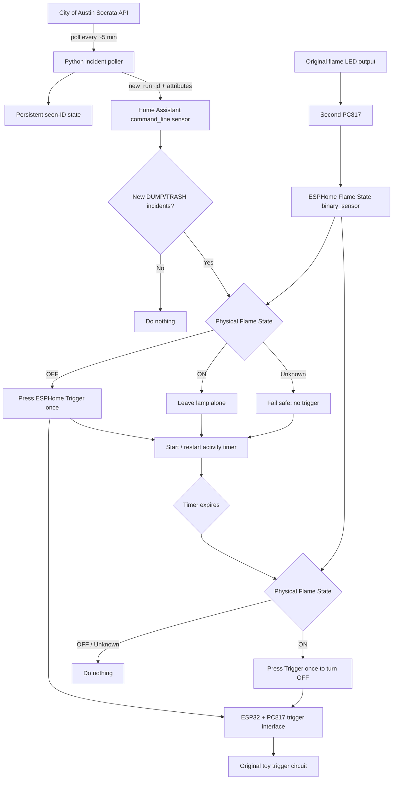

# Dumpster Fire

A physical dumpster-fire night light that turns on when the City of Austin reports an actual **dumpster fire** or **trash fire**.

This started as a joke-sized smart-home project and turned into a surprisingly deep exercise in reverse-engineering a cheap toy, taming an extremely high-impedance trigger circuit, adding real state feedback, integrating ESPHome with Home Assistant, and finally wiring the whole thing to Austin's public fire-dispatch data.

## What it does

The finished system watches Austin's real-time fire incident dataset for these exact dispatch categories:

- `DUMP - Dumpster Fire`
- `TRASH - Trash Fire`

When one or more previously unseen matching incidents appear:

1. Home Assistant records the incident IDs so the same event is never replayed.
2. It checks whether the physical flame LEDs are already on.
3. If the toy is off, Home Assistant presses the ESPHome `Trigger` button once.
4. A configurable activity timer starts or resets.
5. Additional new dumpster/trash fires extend the timer without toggling the lamp again.
6. When the timer expires, Home Assistant checks the real flame state and toggles the toy off only if it is actually still on.

The result is a physical indicator for:

> **Austin has had dumpster/trash-fire activity recently.**

## The toy

The base device is the [**100% Soft Dumpster Fire Night Light**](https://100soft.shop/products/dumpster-fire-night-light).

Stock behavior:

- Flickering LED flame
- Tap-activated
- Battery powered by 3× AAA
- Built-in approximately one-hour auto shutoff

The goal was to preserve the original behavior while adding:

- ESPHome control
- Home Assistant integration
- Real on/off state feedback
- Permanent external power
- Austin fire-dispatch automation

## Architecture



## Hardware

The conversion currently uses:

- 100% Soft Dumpster Fire Night Light
- ESP32-WROOM-32 DevKit-style board
- MT3608 boost converter
- 2× PC817 optocoupler modules
- 1 nF ceramic capacitor
- 4.5 V external DC supply
- Female barrel-to-screw-terminal adapter
- Hookup wire, heat-shrink, solder, flux, and strain relief

The first PC817 handles the **trigger path**.

The second PC817 monitors the existing **flame LED output** so Home Assistant knows whether the lamp is really on or off.

## Why the trigger circuit got weird

The original board does not expose a normal pushbutton input.

The working trigger point was discovered around `Q3` / `R18`, where `R18` is marked `106` — **10 MΩ**. That node is so high-impedance that:

- touching it with a meter probe triggered the toy,
- touching it with a completely floating Dupont wire triggered the toy,
- even capacitively coupling through insulated wire could trigger it.

Directly connecting an ESP32 GPIO to that node was unreliable. ESP boot transitions and other electrical noise caused random toggles.

The stable solution became:

```text
ESP32 GPIO25
    │
    ▼
PC817 input
    │   optical isolation / buffering
    ▼
PC817 OUT
    │
   1 nF
    │
    ▼
R18/Q3 trigger node
```

The PC817 output side is powered from the toy's supply, and the 1 nF capacitor AC-couples the clean transition into the extremely sensitive trigger node.

## Real flame-state detection

The trigger is fundamentally a **toggle**, so command history alone cannot tell Home Assistant whether the lamp is currently on.

The toy may also change state because of:

- a physical tap or bump,
- the built-in timeout,
- a manual Home Assistant trigger,
- power interruption.

The flame LED circuit measures roughly:

- OFF: millivolt territory
- ON: about 3.0–3.5 V
- brief turn-on spike around 5 V

A second PC817 is wired in parallel with the flame LED supply. Its output is connected to the ESP32 and exposed through ESPHome as:

```text
binary_sensor.office_dumpster_fire_flame_state
```

Because the flame effect itself flickers, ESPHome uses a delayed-off filter to smooth the pulses into a stable binary state.

## Austin fire data

The project uses the City of Austin Socrata dataset:

- Dataset ID: `wpu4-x69d`
- API: <https://data.austintexas.gov/resource/wpu4-x69d.json>

The poller looks for the exact values:

```text
DUMP - Dumpster Fire
TRASH - Trash Fire
```

It deliberately does **not** filter only for `ACTIVE` incidents. Matching incidents can become `ARCHIVED` before the next five-minute poll, so the system instead fetches the most recent matching records regardless of status and deduplicates by `traffic_report_id`.

See [docs/austin-fire-data.md](docs/austin-fire-data.md) for details.

## Home Assistant behavior

The Home Assistant side provides:

- Enable/disable helper
- Configurable activity timeout
- Restorable activity timer
- Five-minute poll sensor
- Last-poll and last-incident observability
- Persistent incident deduplication
- Fail-safe handling of unknown flame state
- Timer-driven auto-off
- Operational logging

The implementation is split intentionally:

### Python poller

`home-assistant/austin_dumpster_fire_poll.py`

Responsible for:

- HTTP request
- JSON/schema validation
- persistent seen-ID state
- first-run seeding
- 48-hour pruning
- atomic state-file writes
- emitting a monotonically increasing `new_run_id`

It does **not** know anything about the lamp hardware.

### Home Assistant package

`home-assistant/austin_dumpster_fire.yaml`

Responsible for:

- deciding whether to press the physical trigger
- reading the real flame state
- activity timer behavior
- logging
- enable/disable control
- user-configurable timeout

See [docs/home-assistant.md](docs/home-assistant.md).

## Kubernetes / GitOps deployment

In the homelab, Home Assistant runs in Kubernetes.

The production homelab chart:

1. Packages the HA YAML and Python poller in a ConfigMap.
2. Mounts that ConfigMap into the Home Assistant pod.
3. Copies the files into `/config` during initialization.
4. Loads the YAML as a Home Assistant package.
5. Uses a ConfigMap checksum annotation so changes participate in Deployment rollouts.

This repo keeps project-specific source and documentation together; the homelab repo remains responsible for deployment.

## Repository layout

```text
dumpster-fire/
├── README.md
├── docs/
│   ├── hardware.md
│   ├── esphome.md
│   ├── home-assistant.md
│   ├── austin-fire-data.md
│   └── journey.md
├── esphome/
│   └── README.md
├── home-assistant/
│   ├── austin_dumpster_fire.yaml
│   └── austin_dumpster_fire_poll.py
└── images/
    └── README.md
```

## The journey

This project was not a straight line.

Some highlights:

- Discovering that the toy's "tap" input was not a normal button input.
- Finding a 10 MΩ high-impedance trigger node.
- Learning that a floating wire was enough to trigger the toy.
- Watching direct ESP32 GPIO control randomly toggle the lamp.
- Adding a 1 nF capacitor.
- Buffering the trigger through a PC817.
- Converting the toy from batteries to permanent external power.
- Having the old fake-AAA power adapter fail immediately after the smart conversion.
- Recovering tiny flame-LED solder pads after an ill-fated desoldering attempt.
- Adding a second PC817 so the system finally had real state feedback.
- Discovering Austin's exact `DUMP` and `TRASH` dispatch labels.
- Building persistent, restart-safe deduplication around `traffic_report_id`.
- Adding an activity timer so repeated real-world fires extend the light instead of toggling it off.

The longer narrative lives in [docs/journey.md](docs/journey.md).

## Safety / build notes

This project modifies low-voltage consumer electronics.

A few lessons that mattered:

- Do not connect the high-impedance trigger node directly to an ESP GPIO.
- Verify polarity with a meter instead of trusting wire colors.
- Keep the delicate R18 trigger lead mechanically strain-relieved.
- Insulate the undersides of added PCBs from the original board.
- Treat the flame-state optocoupler as a parallel sensing circuit; do not route the original flame LEDs through it.
- Validate the external supply voltage before connecting it to the toy.
- When reworking tiny pads, pre-tin the wire and pad rather than repeatedly adding solder.

## Status

Working.

The physical lamp can be triggered from Home Assistant, Home Assistant has trustworthy flame-state feedback, and Austin dumpster/trash-fire reports are processed with restart-safe deduplication and timer-based auto-off.

There is, finally, a production-grade pipeline from municipal fire data to a tiny plastic dumpster on a desk.
