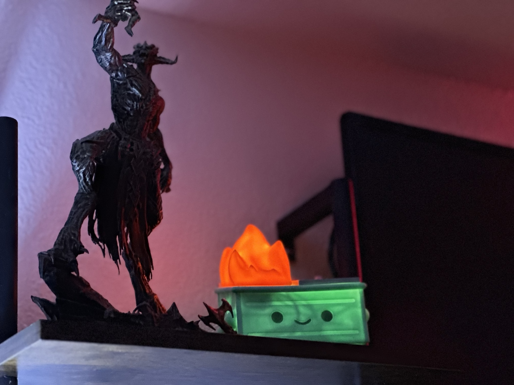
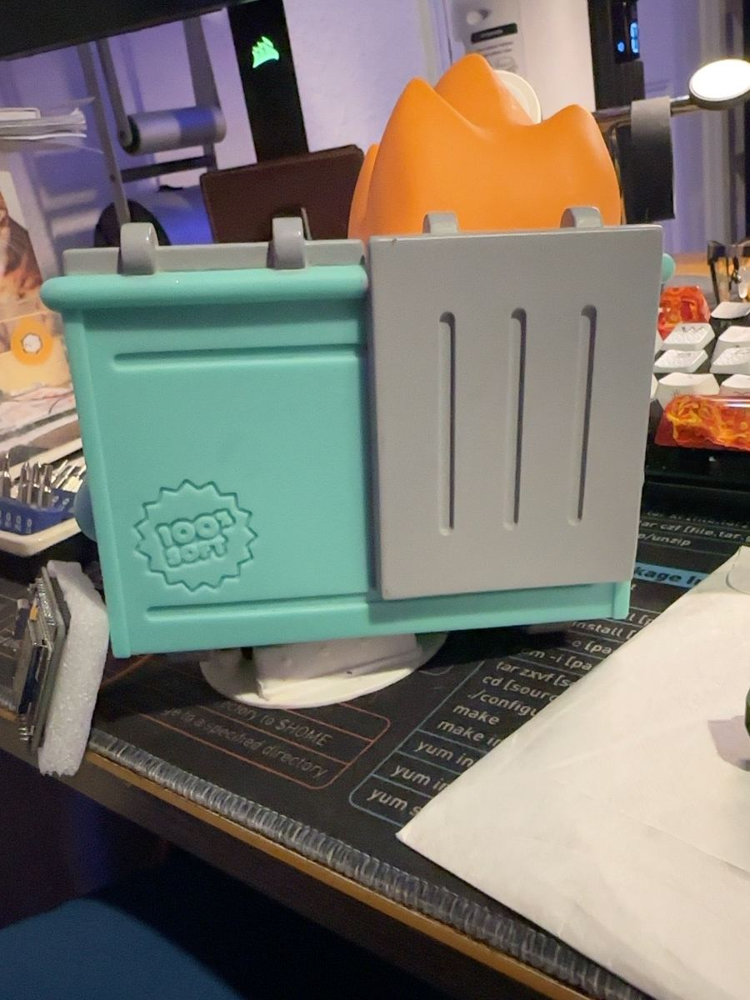
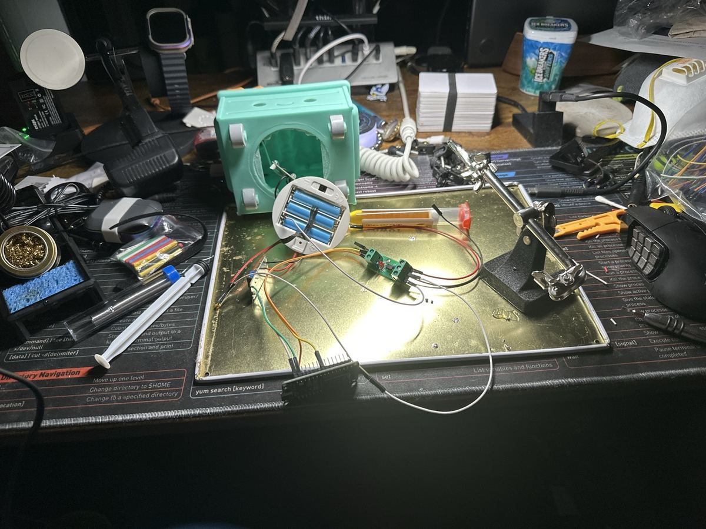
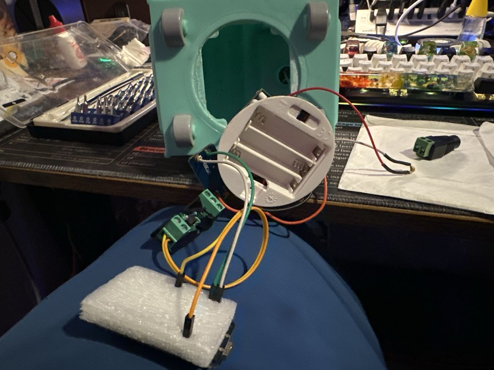
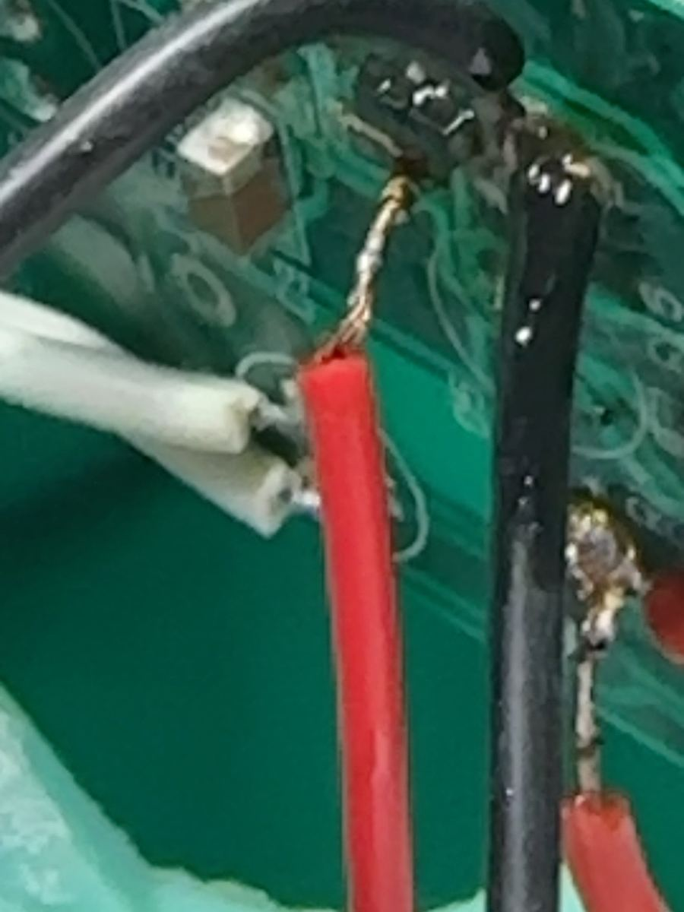
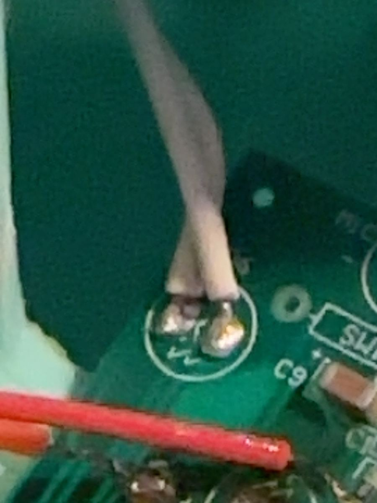
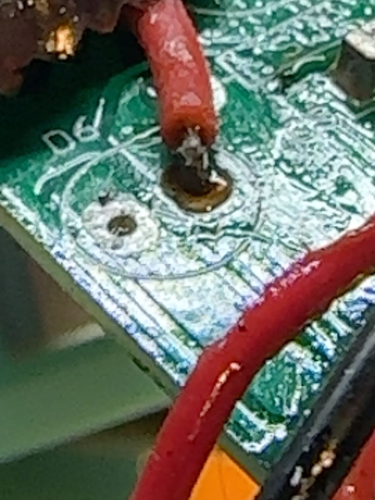

# Project photos

Photos from the project conversation, used in the [main README](../README.md), [hardware guide](../docs/hardware.md), and [build journey](../docs/journey.md).

These include intermediate build stages; consult the hardware guide for the final wiring description.

## Flagship photo

The finished Dumpster Fire lighting up the desk.

## Assembled Dumpster Fire night light

The assembled night light on the desk.

## Dumpster Fire electronics being tested on the workbench

Bench testing with the toy open and the control electronics connected.

## Open base with added control electronics and wiring

The open base during assembly, with the ESP32 and interface wiring outside the enclosure.

## Close-up of the R18 and Q3 trigger connection

The delicate R18/Q3 trigger connection.

## Original flame LED wire connections on the PCB

The original flame LED wire connections before rework.

## Close-up of the flame LED pad repair

Flame LED pad rework during the repair.
